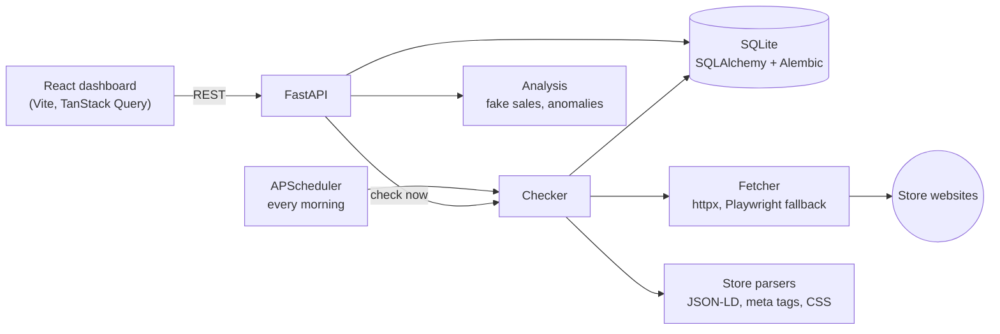

# The Price Diaries

**A personal price diary for skincare and beauty products.** The Price Diaries checks the products you care about every morning across seven Turkish online stores, remembers every price, and tells you when a "sale" is really just a price that was raised a few days earlier.

[](https://github.com/<your-username>/price-diaries/actions/workflows/ci.yml)


<sub>Screenshots use generated demo data (`price-diaries demo`), not scraped prices.</sub>

## The problem

Beauty retailers change prices almost daily. A common pattern is to raise a price, then "discount" it back to where it was a few days later. Without a record, it's impossible to remember whether today's price is actually good. The Price Diaries keeps that record for you.

## Features

- **Daily automatic checks** for Gratis, Trendyol, Amazon, Watsons, Rossmann, Eve Shop and Sephora, plus a "check now" button.
- **Fake-sale detection.** Flags a discount that only undoes a recent price rise.
- **Unusual-rise detection** with a robust statistical method (see below), tuned per product.
- **Loyalty-card prices.** When a store shows a member price (such as Gratis Gold & Platinum), that's the price tracked, with the regular price shown beside it.
- **Target prices.** Set the price you're willing to pay and see when it's reached.
- **Full history** for every product: lowest, highest, 30-day low, and a chart of every check.
- **Local-first and private.** Everything runs and stays on your own computer.

| Product detail | On a phone |
| --- | --- |
|  |  |

## How it works



1. **Fetching.** Pages are downloaded with async `httpx`. Different stores are fetched in parallel, but pages from the same store are fetched one at a time with a random 3–7 second pause, and `robots.txt` is respected. If a store renders its price with JavaScript, the page is opened in headless Chromium via Playwright.
2. **Parsing.** Each store tries, in order: a custom CSS selector you set, [schema.org JSON-LD](https://schema.org/Offer) product data, Open Graph / microdata meta tags, then store-specific selectors. Prices in Turkish format (`1.299,90 TL`) and English format (`1,299.90`) are both handled. Loyalty-card prices are found by their visible label (for example "Özel Fiyat") rather than by CSS classes, so they survive store redesigns.
3. **Analysis.** Each check is stored, and the dashboard reads summaries computed from the full history.

### Detecting fake discounts

There are two complementary checks in [`analysis.py`](backend/src/price_diaries/analysis.py).

**Fake sale (rule-based).** Within the last 14 days, the price rose at least 5% to a peak, has since dropped, and the "sale" price is still no lower than before the rise (within 2%).

**Unusual rise (statistical).** Day-to-day log returns are scored with the *modified z-score* (Iglewicz & Hoaglin, 1993):

$$M_i = \frac{0.6745\,(r_i - \tilde{r})}{\text{MAD}}$$

where $\tilde{r}$ is the median return and MAD is the median absolute deviation. Rises with $M_i > 3.5$ are flagged. Median and MAD are used instead of mean and standard deviation because they are not distorted by the very spikes we're looking for. The threshold also adapts to each product: one that changes price daily needs a bigger jump to be flagged than one that's usually stable.

## Tech stack

| Area | Tools |
| --- | --- |
| Backend | Python 3.11+, FastAPI, Pydantic v2, SQLAlchemy 2.0, Alembic, APScheduler |
| Scraping | httpx (async), BeautifulSoup, Playwright (optional) |
| Frontend | React 19, TypeScript (strict), Vite, TanStack Query, React Router, Observable Plot |
| Styling | Hand-written CSS with design tokens, self-hosted Bodoni Moda and Jost |
| Quality | pytest, Vitest, Testing Library, Ruff, pre-commit, GitHub Actions |
| Tooling | uv for Python, npm for Node |

## Getting started

You need [uv](https://docs.astral.sh/uv/getting-started/installation/) and [Node.js 22+](https://nodejs.org/).

```bash
git clone https://github.com/<your-username>/price-diaries.git
cd price-diaries

# Backend
cd backend
uv sync
uv run price-diaries demo        # optional: adds 12 demo products across all four floors
uv run price-diaries serve       # API on http://127.0.0.1:8000

# Frontend, in a second terminal
cd frontend
npm install
npm run dev                      # open http://127.0.0.1:5173
```

### Stores that need a browser

Trendyol and Sephora render prices with JavaScript, and other stores sometimes do too. Install the optional browser support once:

```bash
cd backend
uv sync --extra browser
uv run playwright install chromium
```

### Stores that block automated checks

Some stores refuse automated visits. When that happens, the product shows "Last check failed" with the reason, for example "www.sephora.com.tr blocks automated price checks", instead of a price. The Price Diaries doesn't try to get around these blocks.

As of November 2026:

- **Sephora** blocks automated checks, both for plain page downloads and in the browser. Prices can't be tracked automatically.
- **Watsons** blocks the browser, but plain page downloads work, so regular prices are tracked.
- **Eve Shop** answered "too many requests" (429) during testing. If you see this, try again later.

### Daily use (one command)

Build the frontend once, and the backend serves it together with the API:

```bash
cd frontend && npm run build
cd ../backend && uv run price-diaries serve
# open http://127.0.0.1:8000
```

While the server runs, prices are checked every day at 09:17. If your computer was asleep at that time, the check runs once when it wakes up. To check without keeping the server open, schedule `uv run price-diaries check` with cron (macOS/Linux) or Task Scheduler (Windows).

### Configuration

Copy `backend/.env.example` to `backend/.env` to change the check time, delays, or database location. If you don't have a store's loyalty card, set `PD_USE_MEMBER_PRICES=false` to track regular prices instead.

## Commands

| Command | What it does |
| --- | --- |
| `uv run price-diaries serve` | Runs the API, the daily scheduler, and the built UI |
| `uv run price-diaries check` | Checks every product once, now |
| `uv run price-diaries migrate` | Creates or updates the database |
| `uv run price-diaries demo` | Adds demo products with fake history |
| `uv run price-diaries inspect <url>` | Shows what every parsing strategy finds on a product page (add `--browser` to render JavaScript, `--save page.html` to keep the HTML) |
| `uv run pytest` | Backend tests |
| `npm test` | Frontend tests |

Interactive API docs are available at `http://127.0.0.1:8000/docs` while the server runs.

## Project structure

```
backend/
  src/price_diaries/
    api.py          REST endpoints, serves the built UI
    checker.py      fetch, parse and store prices
    fetcher.py      polite async downloads, Playwright fallback
    parsers/        price extraction; sites.py lists the stores
    analysis.py     summaries, fake-sale and anomaly detection
    security.py     URL allowlist (SSRF protection)
    scheduler.py    daily job
    migrations/     Alembic schema migrations
  tests/
frontend/
  src/
    pages/          dashboard and product detail
    components/     Price, Sparkline, PriceChart, AddProductForm
    styles/         design tokens and styles
docs/               screenshots and design notes
```

## Security and responsible scraping

- **SSRF protection.** The server fetches URLs that users submit, so every URL must be HTTPS, on a known store domain, with no credentials or custom ports. This blocks requests to `localhost`, private IPs, and cloud metadata endpoints. See [`security.py`](backend/src/price_diaries/security.py) and its tests.
- **Local only.** The server binds to `127.0.0.1` because the app has no login.
- **Polite by design.** One request at a time per store, random delays, `robots.txt` respected, and one check per day.
- **Personal use.** This project is for personal, educational use. Store terms of service may restrict automated access. Amazon, for example, prohibits it. Collected price data is never committed to this repository.

## Design

The interface is modelled on print beauty editorials rather than a typical dashboard. Prices are set like shelf tags in a Didone typeface, with kuruş raised and underlined. Read the reasoning in [docs/design.md](docs/design.md).

## Roadmap

- [ ] Notifications when a target price is reached (desktop or Telegram)
- [ ] Compare the same product across stores
- [ ] Import and export price history as CSV
- [ ] Learn typical sale cycles per store to predict the next drop

## License

[MIT](LICENSE) © 2026 Emine Noor
