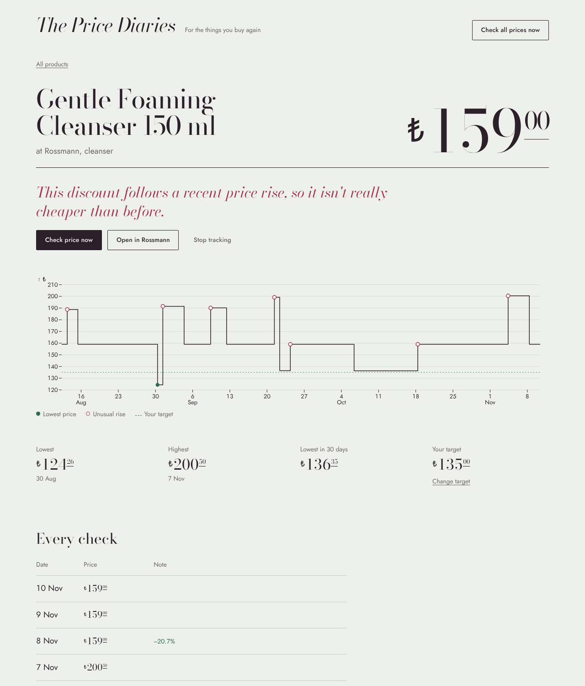
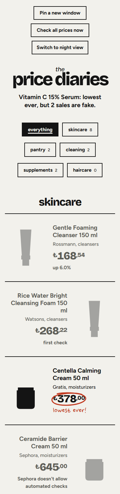
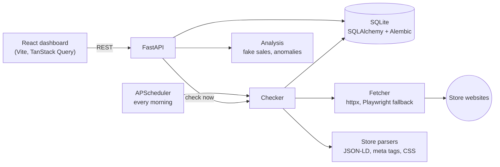

# The Price Diaries

I kept losing track of skincare prices. A serum would go up one week and come back "on sale" the next, at the same price as before. So I built this: it checks the products I follow every morning, keeps every price, and tells me when a sale isn't real.


| Product detail | On a phone |
| --- | --- |
|  |  |

It runs on my own computer, and nothing is sent anywhere. The screenshots use demo data.

## What it does

- Checks Gratis, Trendyol, Amazon, Watsons, Rossmann, Eve Shop and Sephora once a day
- Flags fake sales, where a price goes up and then "drops" back to where it was
- Flags unusual price jumps using the modified z-score on daily price changes, so a product that changes price often needs a bigger jump
- Tracks loyalty-card prices, like Gratis Özel Fiyat
- Compares the same product across stores per ml or gram
- Leaves a note in the app and on the desktop when something changes

Sephora blocks automated checks, and the app doesn't try to get around that.

## How it works



Details in [docs/how-it-works.md](docs/how-it-works.md).

## Run it

You need [uv](https://docs.astral.sh/uv/) and Node.js 22+.

```
cd backend
uv sync
uv run playwright install chromium
uv run price-diaries demo     # optional demo data
uv run price-diaries serve

cd ../frontend
npm install
npm run dev                   # http://127.0.0.1:5173
```

More commands and settings are in [docs/usage.md](docs/usage.md).

Built with Python (FastAPI, SQLAlchemy, Playwright) and React with TypeScript.

MIT license
